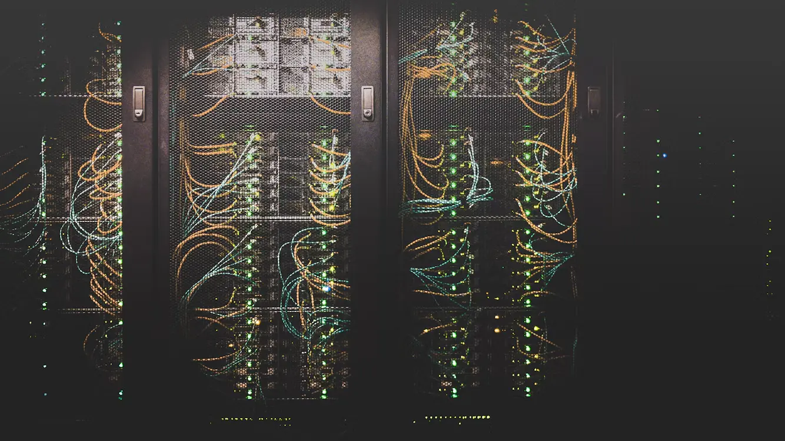
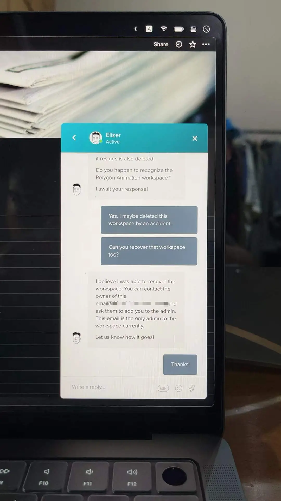
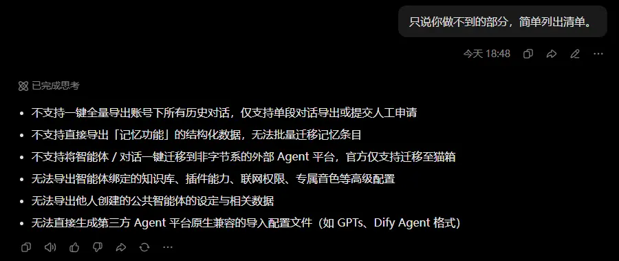
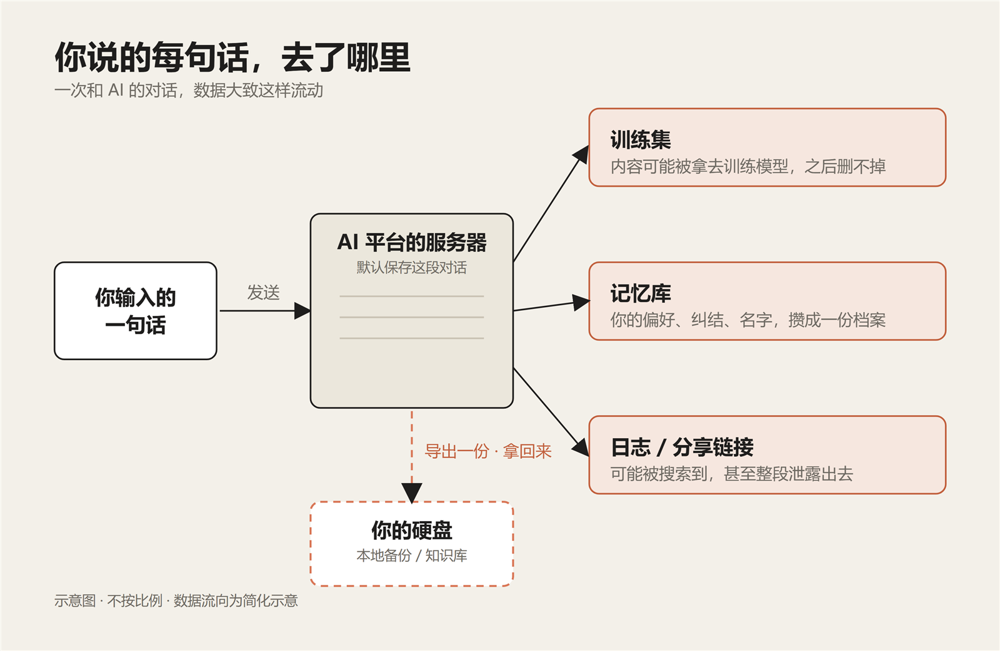
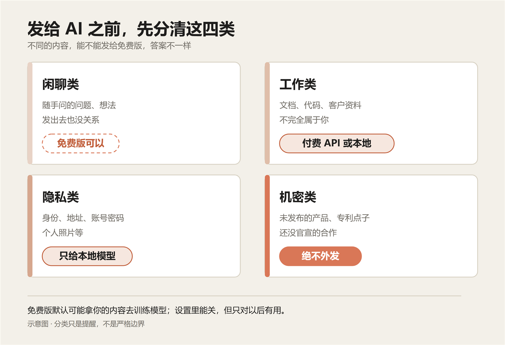
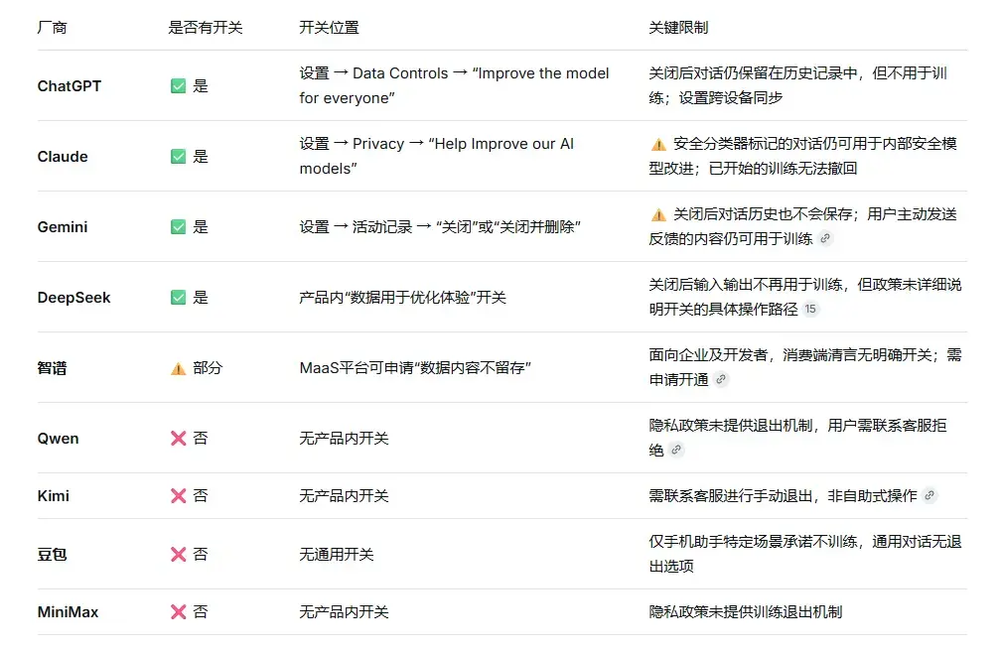
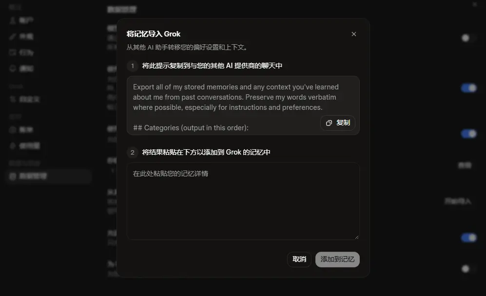
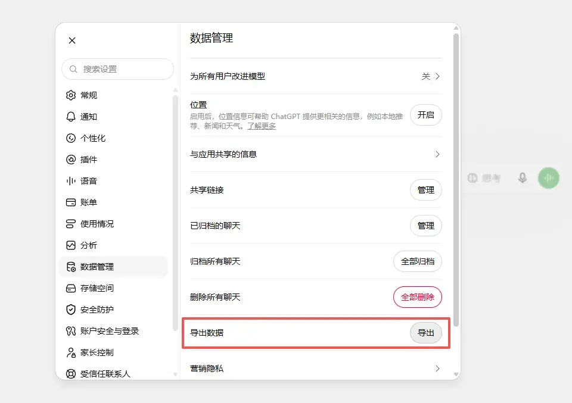
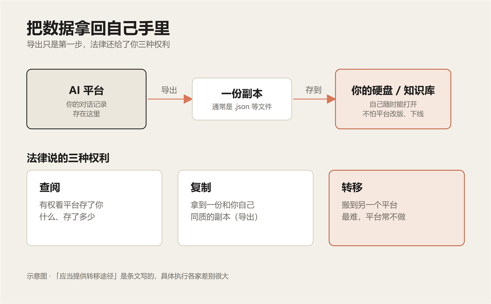
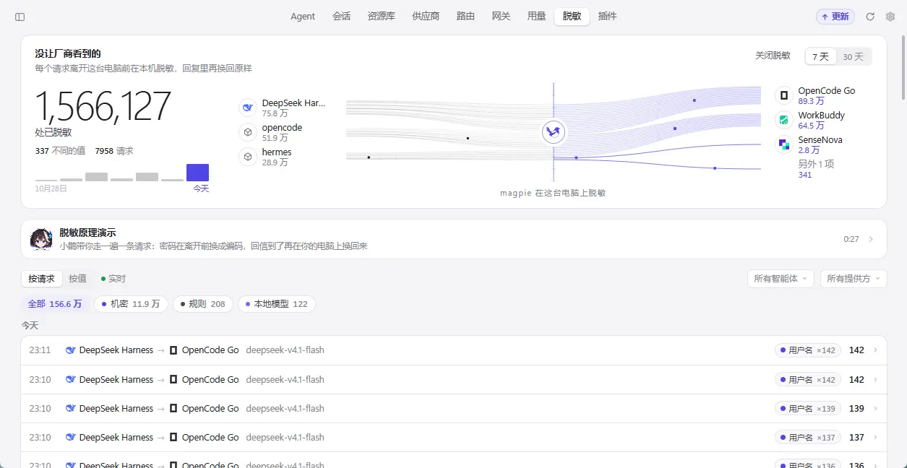

## 写在前面

**AI 辅助创作披露**，本文基于作者真实经历独立完成，后期使用 AI 工具（DeepSeek 及 [Quill Skill](https://github.com/cgartlab/quill) 结构化写作技能）进行润色与部分资料核查。

上一篇聊的是即使你还在用网页版 AI 工具，强调的是慢一点，找回阅读文字的耐心，长期目标是从规则执行者变成规则设计师。那么在使用更复杂的 AI 功能之前，我想技巧都可以往后放放，先养成基本的好习惯。好比跑步看着简单，不知道保持正确的姿势，也会伤膝盖的。

## 从 Notion 说起，为什么要重视你的数据

事情发生在两年前的一个下午。我打开 Notion，数据库页面一片空白。刷新，空白，换手机查看，还是空白。

翻了同步记录才发现，是某次同步出了岔子。我写在那里的上百条笔记、数据库、参考图片，就这么没了。Notion 当时还没有做本地缓存功能，我连「从历史记录恢复」这个选项都没有。

找客服来回折腾了三个多小时，数据才算追回来，但那个下午也匆匆过去了。从那天起我才意识到这个非常现实的问题，云服务到底能可靠到什么程度，我才会把数据安心保存在云服务器（别人的电脑里）？最终我的选择是，也并不拒绝云服务，只是之后的选择更加慎重，而本地是一定要留一份数据的。本地数据就算自己意外弄没了，也认了。

不能天真地以为云端那些笔记是「自己的」。就算充了 SSSVIP，用户也只是买到了一个访问权限。这东西平台随时可以收回，而你说不了半个不字。可以说自从在 Notion 上弄丢一次数据那天开始，我真正意识到并开始重视「数据主权」这个问题。

今年，我开始重度使用各种 AI 工具，ChatGPT、Claude、DeepSeek、Gemini，轮着用。每天在对话框里敲下无数想法，工作上的困惑、学习中的思考、随手冒出的灵感。有时候聊得深入了，一段对话能延续好几天。

AI 本身就是用数据训练的，从这个角度看，我把想法敲进去，云端一定会拿到并保存我的对话历史。可哪天我想换个平台，能把这些数据原样带走吗？这些内容是我一个字一个字敲出来的，模型通过我的输入计算返回的结果，这一堆数据到底算谁的？

蒂姆·伯纳斯·李说过类似的话。他推动的 Solid 项目专门研究怎么让数据归个人所有，核心理念就是每个人直接控制自己的数据。这位万维网的发明者，早几年就在推「数据主权」这个概念。我非常认同，AI 时代每个人的数据应当由自己控制，而不是被锁在某个平台的数据库里。可现实是，我们正朝着反方向走。

「数据是新的石油」，这个比喻在互联网时代流行了很多年。它背后的逻辑是，数据是一种资源，可以被开采、提炼、变现，可现在我总觉得哪里不对。

石油是地底挖出来的，本质属于自然；但用户的数据是经过人思考，互动，输出得来的产物。把两者等同，等于默认平台有权开采你脑子里的东西。这个逻辑经不起推敲，推敲更深一些甚至是细思极恐的。而如今 AI 正在加速渗透到几乎全部数字化的生产流程中，人们在使用 AI 的过程中，随之产生的数据必然是指数爆炸增长，并且这些数据会涉及更多个人隐私的领域。因此，在我看来，在具备了耐心阅读文字的前提之后，使用各种 AI 产品（也适用各种互联网产品）至少需要了解以下几个问题：

- 这个平台如何看待和处理用户隐私数据？
- 这个平台的工具是否能够完整迁移或导出？
- 迁移或导出数据的步骤是否繁琐复杂？

你可以在决定是否用它之前直接问 AI，一般都会得到详细解释。比如，以目前国内用户量最大的豆包举例，这是 [我询问得到的回答](https://www.doubao.com/thread/xnSdlD2kY67RglfCk)，摘录一部分如下：

我认为，未来人们会无比依赖 AI 工具，而用好它的第一步，是清楚意识到和数据相关的基本规则，所有涉及提示词的技巧反倒可以往后放。

## 开始与 AI 的免费会话，安全第一

最开始我不认为和 AI 的聊天数据会存在什么问题。注册 GPT 的时候，登上去直接就开始聊了，从 2022 年的「假如你是马斯克」到如今「这个方案如果跨界到新的某个领域该如何评估成本和报价」。网页版的 AI 我大多数时候就是当 Google 在用。

大多数人平时并不太留意自己的隐私信息。和免费版 AI 聊天时暴露出去的信息，在我看来不亚于一次和朋友面对面的视频通话，你把当时的处境、需求、情绪、姓名和观点都交了出去，只是自己看不见对面是如何保存和处理的。

2025 年 1 月，DeepSeek 的数据库被公开暴露在了互联网上。内容是 100 万条以上的日志记录，其中包含用户的明文对话历史。

那些聊天记录里的内容，很多是「帮我写辞职信」「我最近在面试 XX 公司」「我和老婆吵架了，她说了 XXX 话」。这些是对个人最私密的事，结果被挂在网上，谁都能搜到。

另一个是 2025 年 9 月，有人在 Google 搜索里发现，平时用 Claude「分享」功能生成的公开链接，会被搜索引擎自动收录。有记者顺手搜了一下，翻出近 600 条别人共享的对话，里面甚至有加密钱包的种子短语、API 密钥和求职简历。黑客没参与，是你自己点了下「分享」，就把它变成了谁都能搜到的东西。

这事后来又被报道过。头一回闹那么大，各家都说修好了，可该漏的还是漏。就算 Anthropic 把我的号封了，我也无法确定他们会怎么处理我的数据。我以前也觉得，只要不做什么违法的事，就没什么好担心的。

那你有没有把公司的资料发给网页版 AI 分析过？文档表格、代码、产品规划、客户数据，图省事就直接贴上去了。

公司的资料不完全属于你。你发上去的时候，多半没跟同事打过招呼，也没问过上级。可这种事，你的上级自己可能也在干，大家心照不宣。一旦真出了事，AI 并不承担后果，担责的是那个发内部信息上去的人。我把发给 AI 的内容分成了大致四类：

**闲聊类**，随手发出去的问题和想法。这是免费版最适合处理的内容，行为和正常上网一样，谁看了也没关系。

**工作类**，涉及资料文档或代码。这类尽量使用主流平台的 API 调用功能，通常需要付费。有条件的话，也推荐使用本地部署模型，工具有 Ollama、LM Studio 等。

**隐私类**，涉及身份、身体状态、地址、账号密码、个人照片等敏感信息。绝不建议发给任何云端模型服务，只有本地部署的模型可以确保相对安全。

**机密类**，还没公开的信息。公司未发布的产品，没提交专利的点子，没有公布的战略合作，正在谈的投资等。这个如果出了事，最麻烦的地方在于你没法证明到底是怎么泄露的，因为云端大模型到底如何运作依然是不透明的。

### 你从未看过的用户协议和隐私政策

2022 年中国青年报社会调查中心问过 1561 个人，70.9% 的人很少或从没读过 app 的用户协议和隐私协议，其中 20.5% 一次都没读过。换成 AI 产品的服务条款，只会更长，读的人只会更少。

不读它并不等于没人在乎这些。同一份调查里，54.5% 的人说这些协议的问题是「不同意则不能用」，你没有别的选项。我让 AI 简单分析过国内几家主流的用户协议和隐私政策，如下图。（这个方法真不错）

这是一份对照表，详细对比见 [三平台隐私政策对照（DeepSeek 分享）](https://chat.deepseek.com/share/e80fspmz1hfgwpq0hc)。每个平台的说法多少都不一样，共同点有一个。至少在免费版上，用你发送的信息作为训练数据是默认开着的，你注册账号的那一刻，你的数据就已经在路上了。

这个开关是可以关掉的，在设置里找找就能关掉。我在系列第一篇也讲过，使用任何软件，只要愿意点开设置按钮看一看和试一试，我相信已经超过了 90% 的人。

### 关于「零数据留存」：能不能聊完就抹掉

关掉训练开关，只是说以后不再拿你的内容去训练模型。聊天记录还留在人家的服务器上，该审的还要审，法律要求留的也还得留。真想让它连存都不存，是另一回事，行话叫「零数据留存」，英文 Zero Data Retention，简称 ZDR。

所谓 ZDR，就是请求处理完，服务商不再保留你发出去的输入和返回的输出。当然法律要求留、或者涉及违规调查的，还是得留。

我们平时用的网页版，基本给不了这个。能做的就是把训练关掉，个别平台还给了个临时对话。具体到这四家，路径和结果不太一样：

- ChatGPT，在设置里关掉「为所有用户改进模型」就行。想要更干净就用临时对话，它不进历史、不训练、也不记你，但出于安全考虑，平台最多留 30 天。
- Claude，在设置 → 隐私里关掉「帮助改进 Claude」。你要是允许它训练，去标识化之后的数据最多留 5 年；删掉对话的话，30 天内会从后端清除。
- Gemini，在设置与帮助 → 活动里把「保留活动」关掉。关掉之后新的对话不进活动、也不拿去训练，不过系统还会留 72 小时；被人工看过的那部分最多留 3 年。它默认 18 个月自动删除，你可以改成 3 个月或 36 个月。
- 国内的 DeepSeek 和豆包，也都有关闭训练的开关，DeepSeek 在「设置 → 数据管理 → 数据用于优化体验」，豆包在「设置 → 隐私与权限 → 帮助模型改进效果」。但这两个开关只管训练，聊天记录照样存着，直到你自己删掉或者注销。另外按《网络安全法》，网络日志还得留够六个月。我查到的这几家国内产品，目前都没有给个人用的零留存。

比起网页版，API 和企业服务更有可能给到 ZDR，但通常得单独申请，按组织或项目开通。OpenAI 的接口默认会把滥用日志留 30 天，符合条件的客户可以找销售申请零留存。Anthropic 的 API 默认 30 天内删掉，ZDR 也按组织申请，个别受关注的模型除外。微软和亚马逊也有类似的口子，Azure 可以申请修改滥用监测，批准后不再为人工审查保存请求和回复，Bedrock 默认就不存输入输出。

Google 那边也能申请豁免滥用日志，不过搜索、地图这类联网查来的数据，仍会单独留一段时间。

再往下，就只剩把模型装在自己电脑上了。DeepSeek 的开源模型、Llama 这些，用 Ollama、LM Studio 拉下来本地跑，数据不出机器，也就谈不上留不留。代价是要有够用的显卡，能力也比云端旗舰弱一些。

对我们大多数人来说，现实能做的就是前面那一步：训练关掉，敏感的内容用临时对话。真要一点都不留，得靠企业合同，或者上本地模型，没有一键的办法。有些工具号称「隐私优先」，也值得多看一眼，看它说的是「不训练」，还是「不留存」，这俩不是一回事。

### 当 AI 开始拥有长期记忆

还有件事比泄露更隐蔽一些，现在的 AI 是会记着你的。今年各家网页版的 AI 都陆续上线了「记忆能力」，随时会保存你的习惯和喜好，下次对话它就能想起你的偏好，想起你上周纠结过的方案。当然这在使用体验上是非常人性化的，可换个角度想，你的偏好、你纠结过的事、你随口提过的牌子，这比过去刷视频和点击网页留下的痕迹丰富了数十个维度，可以说在 AI 和实名制的加持下，用户就是透明的。

这个局面，是拿私人信息换便利。我们虽然改变不了它，但我还是希望能看到这篇文章的你，能够了解到这些信息。一个平台产品越懂你，你会越舍不得走；用得越久，你攒在这里的数据越多，未来换平台要付出的代价就越高。

拿 ChatGPT 网页版举例，配置记忆功能的入口就在设置 → 个性化。如果你经常用它，我建议隔一段时间去看一眼，确认它记得的确实是你愿意让它记住的。

### 不容忽视的版权问题

另外，如果你和我一样从事创意类工作，版权问题也需要注意。你贴进对话框的文章、图片、代码，是不是都经过授权？让 AI 总结一本电子书、改一份别人的设计稿，这些动作在平台条款和法律上，边界其实并没有划清。输入这一侧相对清楚：你贴进去的文件、资料等内容，你要有权贴，或者至少得知道自己在贴什么，这层应该没什么争议。

麻烦在输出这一侧：国内没有专门的 AI 版权法，靠的是《著作权法》加近两年的判例。一条 AI 产出算不算作品，看人对生成过程有没有实质的独创性投入。

有投入，就可能构成作品，著作权一般归使用者，AI 自己不能当作者。北京互联网法院 2023 年「AI 文生图」第一案就是这么判的。

要是只敲了几句简单提示词、又拿不出创作过程的记录，法院也可能认定它不构成作品。江苏 2025 年那个「透明艺术椅」案就是这样。

更现实的问题是，AI 生成的东西造成抄袭，责任算谁的呢？2026 年 9 月，最高法发布《关于依法审理涉人工智能纠纷案件的意见》，这是国内第一份涉 AI 的司法裁判规则文件。它把归责原则定成有过错才担责，使用的人是直接行为主体，开发者、提供者按参与程度、训练数据来源、有没有采取必要措施、获利多少来分责任。

还有最大的一块空白在训练数据：拿别人的作品训练 AI，到底算不算侵权，现在没有定论。相关几起案子还在审，法院只要求开发者讲清训练数据来源，没有正面认定训练就是合理使用。

还有一种更常见的：让 AI 总结一篇别人的文章，输出的内容到底算原创还是衍生、原作者能不能主张维权，现在也没有统一说法。**目前唯一确定的是，出事了 AI 不会担责，担责的只能是人。**

## 主流平台的数据导出

在清楚认识到数据可导出的重要性后，当你真导出来用过一次，会发现至少还有下面几个问题是一定会遇到的。第一是文件导出。AI 平台通常导出的文件是 `.json` 格式，就算你不知道这个格式，相信也能感觉到这文件不适合人去读的，不用怕它，交给下一个 AI 处理就好。需要留意的是，大部分就算知道如何导出的人，也会导出之后就放着不管了。

第二是手动蒸馏。如果这个平台不支持完整导出数据，很多主流平台也会在配置长期记忆的位置，提供一份提示词，发给需要导出的平台，就会把它对你的记忆给「蒸馏」出来。例如下图所示的 Grok AI，但注意这么做是下策，效果一定是不如直接喂给它文件的。

第三是复盘和审计。导出的对话隔段时间可以让 AI 重新翻一遍，总能发现自己当时为什么那样决定、哪个思路后来走对了，这对我来说非常有价值。

审计这点还是 AI 提醒我才发现的，导出的数据里，一定会存在你忽略掉的信息。这些信息很多也会藏在模型的思考过程里，而思考过程平时几乎是没人会耐心看的。但这些信息同样会从侧面反映出你的决策路径，而不是被人脑记忆过滤之后的版本。虽然这点我觉得没有前两条重要，但也是有用的。主流 AI 平台的导出功能基本都在「设置」里。

我现在习惯每两个月导出保存一份，然后让本地模型定期把这些数据提炼蒸馏到一个自己和 AI 的共享知识库里，再结合对应的 skill 来按需提取，辅助 AI 更好执行任务。目前感觉效果还不错，具体做法下文会简要介绍，以后有机会再单独展开。

## 法律与数据可携带权

先声明，我不是法律专业人士，这一节写的是我查到的结果，如果你自己查到的和这里不一致，以你查到的为准。上一节讲的是怎么导出。但数据锁在别人那儿，能不能顺利搬走，得看平台脸色。我去查了一趟法律，本来没抱什么指望。

我抱着「法律肯定站平台那边」的心态去翻《个人信息保护法》，结果翻到第 45 条，整个人愣了一下。这条没几句话，就两层意思。第一，你有权向平台请求查阅、复制你的个人信息；第二，你请求把自己的数据转移走，符合条件的，处理者应当提供转移的途径。

翻译成大白话，你存在平台里的对话记录属于你，平台有义务配合你拿走。这就是「数据可携带权」，原来法律早就在用户这边。

我查到的研究里，这条款被反复提到关乎分配正义，不只是技术条款上的小修小补。平台拿用户的数据训练模型、优化产品、赚着大钱，但用户并没有获得这部分价值，结果连把用户自己那份数据带走都做不到。继续深挖我又发现，欧盟 GDPR 第 20 条也提到了类似内容：数据主体有权以结构化、常用、机器可读的格式获取自己的数据，并有权把它转移到另一个控制者。但目前的普遍局面是，法律写了你有权，不代表平台就配合，我只能尽量把我认为有价值的信息整理分享给你。

## 我是如何管理本地 Agent 数据的

前面讲的是怎么从平台把数据拿回来；再往前走一步，是我自己在电脑上怎么管这些本地数据。

目前 DeepSeek Harness 作为我的主力，负责开发、辅助写作和设计等生产工作；OpenCode 跑在 NAS 上，连着 GitHub 做云端维护和审查；Hermes 独立作为私人助手，处理信息收集，投资，统计分析后台数据等生活类工作。

那么这就导致每台设备里都散着不同的数据，每个项目任务的进度也不同。这些数据总体分成三类：会话、配置文件和资源、私人敏感数据。

### 会话数据蒸馏和定期清理

本地 AI 产生的会话数据通常都会根据工具不同存放在不同位置，我更换了几次之后就决定不管它们在哪里了，过于繁琐耗时。

于是我问 AI 会话数据的本质和价值，它给出的解决方案就是建立一个独立的长期记忆仓库，在我看来更像一个 AI 和我的共享知识库。

按照我的工作流把它大致分为以下几个层级：

- **原始会话**：就是电脑上产生的原始会话文件，只读取它们，不入库。
- **蒸馏层**：定期提取分析我的决策，通过一系列算法来评估偏好和教训。
- **沉淀层**：汇总和分析最近一段时间我的偏好和教训，给出判词，我手动确认和改进。
- **路由层**：表层总索引，用来让 AI 顺藤摸瓜检索记忆和信息，随着数据积累和模型能力增强，我想应该会越来越好用。

此外就是定期做一次会话清理，已经有了这个共享知识库，我把自动清理的规则也集成到了蒸馏的最后一环，打包成一个 skill，随着共享知识库一起迭代。每次蒸馏之后都会自动扫描过时且价值不大的会话，例如海量的子智能体会话，测试会话等。

### 配置文件和资源统一管理

随后是配置文件和资源，配置文件通常包含系统提示词、模型厂商的配置参数信息、个性化设置等等，每个 AI 工具都不一样。资源通常包含 MCP 服务、Skill 等。

由于技术发展变化极快，我尝过几次切换工具的相见恨晚之后，慢慢思维方式就变成了去找到瞬息万变的表象之下，不变的那个规律和原理。

我目前使用 Magpie 对配置文件和资源进行统一管理，一个月前还是 CC Switch。Magpie 的核心能力就是在不同的 Agent 工具和订阅服务之间架起一个轻量稳定的交换机，你也可以按照自己的喜好智能安排先用谁家的哪个模型，多个账号也可以。自由度非常高，开发者是我非常敬佩的 yetone 老师。

除此之外，还有多设备同步、Docker 部署、统一的系统提示词、MCP、Skill、额度查看、用量统计、信息脱敏这些非常戳痛点的功能。

### 密钥与敏感数据单独处理

在使用 AI 的时候，绝对不建议把账号密码信息直接发过去，除非你不打算要这个号了。那么在电脑上如何让 AI 来安全读取你的账号密码以及其他 API 的密钥，大致分成两种情况处理：

- 账户和密码永远不要发给 Agent，但可以给它一个已经登录好的会话或服务。
- API 密钥不要写进代码、也别提交进仓库，用环境变量或密钥管理器在运行时注入。这样能保证密钥不进模型的上下文，同时定期轮换、只给最小可用的权限。

核心原则就一句：**明文的任何账户密码这类信息，绝不要让它们进入模型的上下文，一旦发现，立刻修改和轮换。** 环境变量不是保险柜——Agent 和你共用系统账号，能跑命令就能读到它。真正的防线是让明文永远不落进对话和日志，再靠 Magpie 这类网关在中转时做一层脱敏。

如何管理好本地数据我也踩了很多坑，整体的处理核心思路就是：

- **工具得先顺手**，我的选用优先级是：适配工作流 > 核心功能和维护稳定 > 资源占用比竞品少 > 好看。
- **会话多了不要有心智负担**，之后就能放开使用各种 Agent 团队了。
- **生产环境一定要用付费大厂服务**，出了事虽然 AI 不担责，但至少有据可查。

## 总结

用任何 AI 工具之前，先弄清自己的数据从哪来、到哪去，我认为比先学什么技巧都更有长期价值，养成好的使用习惯，未来必会事半功倍。就像开头说的跑步，姿势不对，跑得越多膝盖受损越严重。AI 也一样，提示词写得再天花乱坠，如果连自己的数据存在哪、能不能带走都没搞清楚，迟早会有更严重的问题暴露出来。另外，注意分清哪些内容能发给免费的网页 AI、关掉训练开关、定期导出会话历史、看清版权的边界，再适当了解一些法律常识。

这个系列第一篇讲的是慢一点，先把读文字的耐心找回来，从规则执行者变成规则设计师。这一篇，是把「数据」这块地基先打好，地基有了，下一篇才好聊提示词——怎么把想法变成一套能复用的规则，让 AI 按你的方式去乖乖干活。
