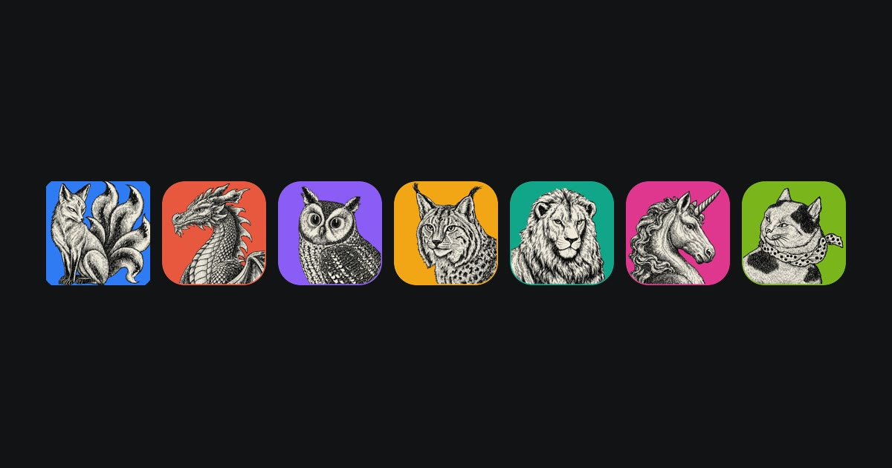
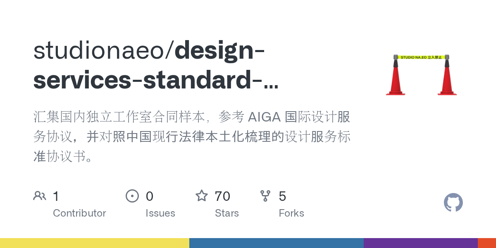

This issue's cover comes from [Apple's website](https://www.apple.com.cn/os/).

> **Xuanguang Column · No.25**
>
> A digital column focused on accelerating productivity, covering knowledge management, motion visual design, and front-end development. Published at least twice a month, each issue explores a single theme.
>
> Every link I share is embedded as a hyperlink on a keyword. **WeChat official-account articles in 2026 don't support this**, though other platforms have no such problem.
>
> WeChat scans article bodies for third-party links and flags them as promotional violations. So if you're reading this inside WeChat and want one-tap jumps, tap **Read original** at the bottom.

---

## Key Takeaways

- Apple's most-copied ideas almost never headline a keynote. They are interface details that competitors quietly adopt for years.
- **Touch and motion** (Taptic Engine, non-linear spring animation, Dynamic Island) exist to make on-screen content feel physically real.
- **One continuous curve** runs through the body, screen, icons, and the San Francisco typeface; a single true circular corner breaks the whole idea.
- **Standardizing what others invented** (home-screen widgets, dark mode, notification summaries) turns features into defaults the rest of the industry builds on.
- **Erasing device boundaries** (AirDrop, Handoff, Universal Clipboard) changes the question from "where is the file?" to "what do I want to do?"
- The test of a design worth learning: does it save everyone after it the cost of explaining it?

## Not Revolutionary, Yet Copied Hard

Every time Apple launches a new product, I go browse its website for a while. I've kept this habit for years, because — for better or worse — they always manage to come up with something new in the design and interaction of the site itself. You rarely see that from other brands.

Browse enough and you start to notice: the practices other brands copy, the ones that resurface across countless products every few years, or ones where you can plainly see the shadow — almost none of them are the focus of a keynote.

In consumer electronics, every brand is constantly exploring and learning. What strikes me about Apple is that they always seem to have a set of insights and approaches of their own. They may no longer hit the phenomenon-level impact of the iPod or iPhone 4 eras, but across the decade-plus Cook has run Apple, there are still plenty of ways of handling problems that creators tend to overlook and that are worth learning from and thinking about. Dig deeper and there may be a methodology in it — though frankly I can't quite figure out or articulate what it is. This piece is just a starting point for discussion; if this subject interests you too, I'd love to hear from you.

### Weaving Touch Into the Interface

The Taptic Engine first appeared in the 2014 Apple Watch. Back then it only had to remind you of a notification, or tell you to stand up and walk a bit. Few people at the time would have guessed it would become one link in an entire interaction chain.

The 2015 iPhone 6s got the Taptic Engine too. Nobody paid it much attention then. The marketing copy only said "more refined vibration feedback," as a supporting feature for 3D Touch.

Before this, people understood phone vibration as having a single function: to alert you that something had arrived, and vibration was just one of the ways to alert you. Once the Taptic Engine entered the phone, vibration became real touch: a long press on an icon pops and gives a little rebound; a scroll wheel turning one notch gives a light click; a payment confirmation gives a solid "thunk." It stopped merely telling you what happened — it let you confirm what you had just done.

Once you've felt this, it's hard to go back. The peak, I remember, was the iPhone 7 launch: its home button — you'd find after turning the phone off — actually can't be pressed down, yet the vibration feels exactly as if you pressed it. Genuinely magical.

Then came the full-screen era, and almost all vibration on the iPhone now serves on-screen buttons. Honestly, I think it would be pretty cool to keep just the power button and turn every other physical key into "simulated vibration" — go extreme, and you could build a body with nothing but a power button.

Over the following years, other brands started using linear motors one after another to get a similar feel. Today it's an industry standard.

> A follow-up thought: why is the iPad the only device that never got a Taptic Engine?

Second, animation.

iOS 7 in 2013 added non-linear spring animation to the interface. Before that, motion was controlled only by duration and an easing curve — things moved at a constant speed, or did simple acceleration and deceleration, then stopped on arrival. After iOS 7, displacement could carry mass and damping: you push it, it overshoots a little, then bounces back.

That layer of change wasn't universally praised at the time. Spring parameters don't follow physical intuition, and developers had to tune them entirely by feel — plenty of apps in the early days bounced too much. But I don't think speed is the point. The point is that after they boldly flattened the UI, they used animation to give weight to airy interface elements. That approach is really the same idea as the Taptic Engine: make the digital content beneath the glass feel real and trustworthy.

The Dynamic Island on the 2022 iPhone 14 Pro is a further step in this direction — turning that camera cutout into a region that stretches with content, has boundaries, and breathes. Only this time the animation exists to keep that annoying notch from being an eyesore.

These three things don't look related: vibration, animation, the Dynamic Island. But they're all handling the same problem — how to make people believe that the things on the virtual screen are real and trustworthy.

### One Curve, All the Way Through

After the 2017 iPhone X, the media broadly began praising how iOS handled rounded corners in both software and hardware.

The four corners of the body, the screen, and the icons don't use a geometrically true circular arc — they use a superellipse with continuous curvature. I introduced this separately before in [Getting to Know Industrial Design Through the Apple Watch](https://cgartlab.com/posts/apple-watch-design/).

The seams of a rounded rectangle go blurry on a low-resolution screen — you can't see them. After the iPhone 4, screens got dense enough at 326 ppi that the seam could no longer hide. I first assumed this was to fix some display defect, but with AI's help I found that the 2013 [patent](https://patentcenter.uspto.gov/applications/13913368) gives aesthetics as the reason — not a word about screens.

Each piece on its own isn't hard. The hard part is that it has to be done across the whole machine at once. The screen's corners have to align with the body's; the icons' corners have to align with the feel of the screen; even the terminal curve of a stroke in the San Francisco typeface has to use the same curve. If any one corner doesn't use this curve, the whole idea falls apart.

Every phone brand that came after has, without exception, started emphasizing how beautiful their own rounded corners are. macOS 26 rounded its icon corners another notch, and [I covered thirty years of icon evolution back in Issue 6](https://cgartlab.com/posts/weekly-06/).

### Turning Someone Else's Invention Into a Standard

Take widgets and dark mode.

Home-screen widgets were not invented by Apple. Android had them early, and Windows Vista's sidebar came even earlier. When iOS 14 shipped them in 2020, many people's first reaction was "hasn't this existed forever?"

What Apple gave was a size grid, unified rounded corners, and a unified refresh mechanism. Once that was done, widgets went from "a square you can put stuff in" to something that could be designed. Third parties started building to that set of rules, and users gradually came to feel they were worth displaying. For a detailed look at widgets, see this UIsdc piece, [How Should the All-New iOS 14 Widgets Be Designed? The Official Design Guidelines](https://www.uisdc.com/ios14-widgets-design).

Dark mode is the same story. When iOS 13 launched it in 2019, Windows Phone had already made dark mode the default back in 2010. iOS clearly put more thought in: which grays to use at which levels, how to handle images, how to use black on OLED — all set as built-in rules, drastically reducing the friction of third-party design and development.

What Apple does in these places is "consolidate and absorb."

Honestly, these purely software details could certainly be done — and done well — if other brands were willing to think one step further. My crude guess as to why: since someone is willing to eat the crab first, we'll wait, let them eat, and if they're not poisoned, then we'll eat. Google is probably the one willing to think a step further — [I talked about their design philosophy specifically in Issue 11](https://cgartlab.com/posts/weekly-11/).

### Making Device Boundaries Disappear

AirDrop in 2013, Handoff in 2014, and Universal Clipboard in 2016.

These three tools, looked at individually, are all minor features: send a file, copy-paste across devices, keep working. But put them together, and at least in my own experience, I started to care less and less about which device a file was on.

Before this, multi-device coordination was a problem you had to manage. You had to know whether a photo was on your phone or your computer; you had to remember which machine had the latest version. After AirDrop, the act of transferring became choosing an identity, not choosing a storage location. After Handoff, a web page you were reading on your phone could be picked up directly on your computer.

There are plenty more of these kinds of coordination — cross-device screen casting, one keyboard and mouse spanning multiple devices, headphones and speakers switching between devices without a hitch, and so on.

These seamless, effortless, yet stable and reliable experiences slowly change users' mental models. People go from "wow, you can do that?" to "that's just how it should be."

### A Recent Change

If, in the full-screen phone era, how to handle the notch or the front camera was an S-tier problem, then for foldable devices the S-tier problem is the experience of folding and unfolding the inner screen. Here "S-tier" means a design problem you can't avoid.

What I find interesting about the iPhone Duo is that when it folds and unfolds, the screen content folded away blurs through the transition, while the side facing the user grows sharper and sharper.

I find this approach fascinating. It gives you a psychological sense that what I'm folding is the frame and glass on the outside, while the content inside the screen is still sitting on that one flat plane. On the surface, hardware and software visually "separate" for a moment, but behind it they're actually bound very tightly together.

Samsung's Galaxy Z Fold 8 launched in July 2026, two months before the iPhone Duo, but it has no folding animation at all: the content simply switches from the outer screen to the inner screen when the phone is roughly half-open.

TMT Post put it more bluntly:

> Foldables have long been able to continue content between inner and outer screens, but how the image transitions along with the folding motion — few have ever studied that carefully. This time Apple connected the motion of the body to the change in the image… for the first time making the act of "folding" a foldable into a visual pleasure.

Counting from Samsung's first foldable in 2019, that's seven full years. The industry kept improving hinge durability, creases, and thickness — and nobody dealt with "the folding itself" as an interaction.

### What It Taught Me

I'm not really an Apple fanboy. The devices I use are just the standard trio: Mac, iPad, and iPhone — and the newest of them are models released five years ago.

From my first iPhone 4 onward, over more than a decade of use, I've come to feel that **Apple is exceptionally good at taking a feature or experience that already exists and reshaping it into a default that any other brand would have to explain if it wanted to do things differently.** That's something every designer should learn from.

It has helped me enormously in design, in writing articles, and in any creative work at all. To judge whether a design idea is worth learning, my heuristic is to see whether it saves everyone after it the cost of explanation — not just users, but everyone who comes into contact with the design.

This standard is universal, too. I applied it early on to [file management and naming conventions](https://cgartlab.com/posts/good-name-for-better-work/), which saved me and my colleagues a great deal of unnecessary back-and-forth. It's the same kind of thing as [design concepts that transfer across disciplines](https://cgartlab.com/posts/weekly-23/): only what works across contexts is a truly good tool.

Turned back on myself, I try, before handing over any deliverable, to ask: does this thing need me to explain it again?

## Frequently Asked Questions

### What ties the Taptic Engine, spring animation, and the Dynamic Island together?

They all solve the same problem: making virtual, on-screen content feel physically real. Haptics give glass a sense of touch, spring motion gives flat elements weight, and the Dynamic Island gives a cutout a boundary that breathes with content.

### Why do Apple's rounded corners look smoother than an ordinary rounded rectangle?

They are not true circular arcs but a superellipse with continuous curvature, repeated across the body, the screen, the icons, and even the ends of strokes in the San Francisco typeface. One corner that falls back to a plain circle breaks the effect, which is why it has to be done across the whole device.

### Did Apple invent home-screen widgets, dark mode, or notification summaries?

No. Android and Windows Vista had widgets first, and Windows Phone made dark mode the default back in 2010. Apple's contribution was standardization — a size grid, unified corner radii, defined gray levels, and refresh rules — which turned existing features into something third parties could design against.

### How does Apple make several devices feel like one?

Through AirDrop (2013), Handoff (2014), and Universal Clipboard (2016). Together they shift the question from "which device is this file on?" to "I just want to keep working," so users stop managing storage locations.

### How can I tell whether a design idea is worth learning?

Ask whether it saves everyone after it the cost of explanation. If people have to be taught how to use it, it hasn't become a default. If they take it for granted the moment they meet it, it has.

---

## What's Been Happening

### I Overhauled the Chinese Typography on All My Sites

Last issue, when I [recommended that piece on Apple's website typography](https://cgartlab.com/posts/weekly-24/), it was only a few days before the author open-sourced the related Skill. I actually put it to use, and went through the typography details on all my sites.

If you don't work in design, you might not notice at all: adding spacing between Chinese and English, pulling stray single characters at the end of a paragraph back up. Finer still — product names and English words must not break in the middle, punctuation has to be optically centered. And so on… a whole pile of good things you can take straight from Apple.

Typography is like a weather forecast: get it right and no one notices, they assume that's just how it is; get it slightly wrong and it's immediately felt.

### 22 Skills of My Own Now

A few days ago I took stock of all my Skill repositories — there are 22 now. They basically cover all of my current workflows. I've been polishing them the whole time over the past half year of frantically learning and using AI, and the results are starting to show.

If you're interested, you can follow me on GitHub — these skills will all be open-sourced for free in the future. Several of them were written up specifically in Issue 18, [which was about packaging scheduled tasks into a Skill once they run stably](https://cgartlab.com/posts/weekly-18/).

Let me take the chance to share roughly how I make them. My thinking was this: the biggest feature of a skill is that it's reusable, and there's something that naturally corresponds to that — called a scheduled task. So why not run a scheduled task stably and then just package it into a skill?

So every time I conceive of a scheduled task, I discuss it with AI a few times, get the task running first, then keep patching it up through the outputs. In the end I still have to personally tweak the prompt by hand to get it decent. After about a week with no major issues, I have AI package the scheduled task into a skill, create a GitHub repo, and cut a release.

Then the scheduled task's prompt becomes: "Every so often, run skill xx, and send the result to xxx" — done. Works every time.

---

## Recommended Tools

### [A Guide to Cultivating Taste in the AI Era (Part 1)](https://x.com/Jaden_riku/status/2102053581830652152) · [(Part 2)](https://x.com/Jaden_riku/status/2102580320830939309)

The author, Jaden, comes from an architecture firm, then went through a string of startups, and is now an indie developer. Part 1 is about why we should talk about taste now; Part 2 is about how to cultivate it. I think Part 2 is the more worth reading.

The line I most agree with in both pieces: what AI tools amplify is a person's original choices. It can give you many versions at once, but which version to pick still requires your own judgment.

The concrete method is very plain: first go see good things, feel them seriously, and become aware of how they differ from what you're used to. Try "feeling with money" more — stay once in a good hotel, buy a genuinely good product; your body will remember things images can't give you.

### [ArtCraft · Crafting Apps](https://getartcraft.com/apps)

The design world has long suffered under Adobe — maybe I have too — and then this suite of software showed up in front of me. It's basically built to go head-to-head with the entire Adobe lineup, but compiled natively in pure Rust, with no Electron and no WebView.

Reviews say it's very light and smooth. I think it's still all in early development — too early to expect it to replace C4D and AE — but it's worth keeping an eye on. What if, right?

### [Sac · The Little Prince: A Journey to the Stars](https://littleprince.dev/)

A 3D story game one person made with AI in 16 days. The tweet got over two million views and likes from A16Z and Marc Lou.

What's worth studying is the process. Fable produced the PRD; Image produced scene art and four-view T-pose sheets; Tripo generated props and character models; Blender plus Auto-Rig Pro handled rigging; Mixamo supplied the motions; complex interactions were then detailed in Blender with IK.

The truly key step is last: Opus, through the Unity MCP, directly drove the Unity engine to build scenes, wire things up, and fix bugs, then dispatched a separate review agent to blind-review against reference images from multiple camera angles.

Once again, I marvel at how fast technology advances.

### [Studio Naeo · Standard Design Services Agreement](https://github.com/studionaeo/design-services-standard-agreement)

Studio Naeo, drawing on its own painful lessons, worked with dozens of leading domestic design studios to compile and publicly share a contract template. Even if you don't use it, it's well worth tossing to AI to learn from.

---

## Next Issue Preview

I've been scrolling X a lot lately and seeing lots of peers looking for work — some even posting tags like "X Hire." So let's talk about how hard it is to find a job, how bad the environment is, and how to make an excellent portfolio.

---

This column first appeared at: [CG Art Lab](https://cgartlab.com)

📮 Letters/collaboration: hello@cgartlab.com
