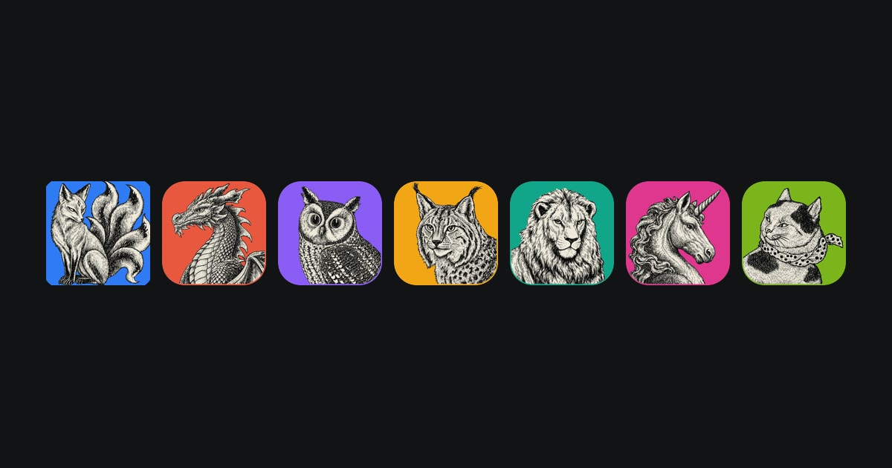
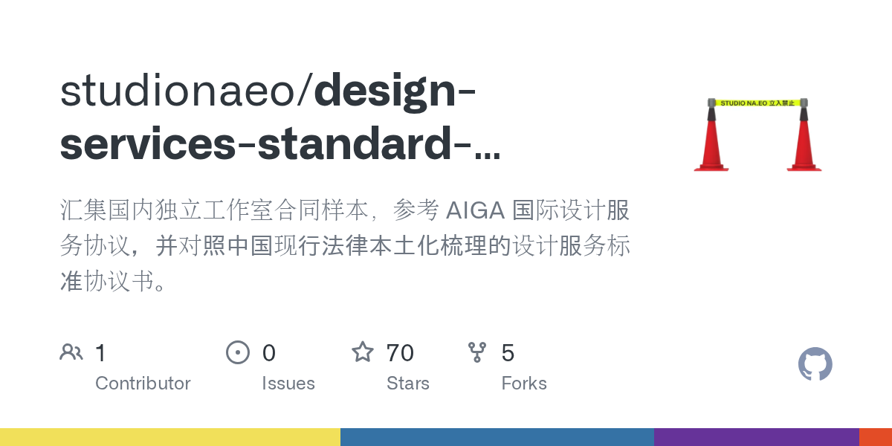

本期封面来自 [Apple 官网](https://www.apple.com.cn/os/)。

---

## 不够颠覆，却被狠狠学习

每次苹果发新品，我都会去官网转一圈，这个习惯保持了很多年，因为无论好坏，他们每次在网站的设计和交互上多少都能玩出些新花样。这在其他品牌很少见。

翻得多了会发现，那些被别的品牌学走的、隔几年就在无数产品上重新出现，或者能明显看到影子的做法，几乎都不是发布会上的重点。

在消费数码领域，所有品牌都在不断探索和学习，苹果这家公司给我的感受是，他们总有一套自己独到的见解和思路，虽没有了 iPod 或 iPhone 4 时代那么现象级的影响，但在库克掌管 Apple 的十几年里，依然存在很多容易被创作者忽视和值得学习思考的问题处理方式。往深讲，这或许有一套方法论在里面，其实我想不明白也说不清楚它们到底是什么，这篇文章也只是抛砖引玉，如果你也对这方面感兴趣，欢迎交流。

### 把触感融入界面

Taptic Engine 这东西最早出现在 2014 年的 Apple Watch 上，那年它还只需负责提醒你有通知，或者站起来走两步，我想当时应该没多少人能想到它会变成整套交互的一环。

2015 年的 iPhone 6s 换上了 Taptic Engine。当时也没人太在意，宣传语仅仅写的是「更细腻的震动反馈」，为了配合 3D Touch 的卖点。

在这之前，人们对手机震动的认知是只有一种功能，提醒你有事情来了，震动也只是提醒的手段之一。从 Taptic Engine 进入手机之后，震动变成真实的触感：长按图标弹起有一下回弹，滚轮转过一格有一下轻磕，付款确认有一下「咯噔」。它开始不光告诉你发生了什么，还让你确认自己刚刚做了什么。

这个东西感受过一次就很难回去，体验的巅峰时刻我记得是发布 iPhone 7 的时候，它的 home 键你关机后会发现其实是按不下去的，但震感真的就像按动了一样，非常神奇。

之后进入全面屏时代，iPhone 上的震动几乎全都服务于屏幕按钮了，其实我觉得只保留一个电源键，其他所有实体按键全都做成「模拟震动」还是很酷的，极致一点，完全可以做出只有电源键的机身。

随后几年内，其他品牌都陆续开始使用线性马达来获得近似的体验，如今已经是行业标配。

> 延伸思考：为什么唯独 iPad 没有加入 Taptic Engine 呢？

第二是动画。

2013 年的 iOS 7 给界面加了非线性的弹簧动画。在这之前，动效只靠时长和缓动曲线控制，东西要么匀速走，要么简单加减速，到位就停。iOS 7 之后，位移可以带质量和阻尼，你推它一下，它过冲一点会再弹回来。

这一层改动当时并不全是好评。弹簧的参数不按物理直觉来，开发者调起来得全凭手感，不少 App 早期都弹得过头。但我觉得快慢并不是重点，重点是他们在大刀阔斧把 UI 做成扁平化之后，利用动画让轻飘飘的界面元素具备了重量感，这种处理方式其实和 Taptic Engine 是同一个思路：让玻璃下的数字内容显得真实可信。

2022 年 iPhone 14 Pro 的灵动岛是在这个方向上的继续推进，把那块挖孔镜头变成一片会按内容伸缩、有边界、能呼吸的区域，只是这次的动画是为了让那个闹心的刘海不再「碍眼」。

这三件事看起来并不相关：震动、动画、灵动岛。其实它们都在处理同一个问题，如何让人相信虚拟的屏幕上面那些东西是真实可信的。

### 一条曲线贯彻到底

2017 年 iPhone X 之后，媒体普遍开始赞赏 iOS 软硬件的圆角处理。

机身、屏幕、图标四角，用的不是几何意义上的正圆角，是曲率连续的超椭圆。我之前也在 [《跟着 Apple Watch 初识产品工业设计》](https://cgartlab.com/posts/apple-watch-design/) 里单独介绍过。

圆角矩形的接缝，在低分辨率屏幕上是糊的，看不出来。iPhone 4 之后屏幕密到 326 ppi，那条缝就藏不住了。我最初以为这是为了修掉某个显示瑕疵，但在 AI 的帮助下发现 2013 年 [那份专利](https://patentcenter.uspto.gov/applications/13913368) 里，理由写的是美学，一个字没提屏幕。

单看不难，难在它必须整台机器一起做。屏幕圆角得跟机身对齐，图标圆角得跟屏幕的手感对齐，连 San Francisco 这套新字体一笔的收尾弧度都得跟它们用同一套曲线。只要有一处圆角没用这个曲线，这个理念就不成立了。

后面所有做手机的品牌都不约而同开始强调自家也做了多好看的圆角。macOS 26 也把图标圆角又调圆了一轮，[我在第 6 期里整理过这三十年图标的变化](https://cgartlab.com/posts/weekly-06/)。

### 把别人的发明整合为规范

比如小组件和深色模式。

桌面小组件不是苹果发明的，Android 很早就有，Windows Vista 的侧边栏比它更早。2020 年 iOS 14 上做的时候，很多人第一反应是「这不早就有了」。

而苹果给了一套尺寸网格、统一的圆角、统一的刷新机制。做完之后，小组件从「能放东西的方块」变成了一个可以被设计的东西，第三方开始按这套规矩做，用户也慢慢觉得它值得摆出来。有关小组件的详细介绍，可以看看优设这篇 [全新的 iOS 14 小组件要如何设计？来看官方设计指南](https://www.uisdc.com/ios14-widgets-design)。

深色模式同理。2019 年 iOS 13 上线时，Windows Phone 早在 2010 年就把深色做成了默认。iOS 显然做了更多的思考，把哪些层级用什么灰，图片怎么处理，OLED 上黑色怎么用，全部定成了内置的规则，大幅度减少了第三方设计开发的摩擦。

苹果在这些地方的动作都是「整合与收编」。

其实这些纯粹软件上的细节，只要其他品牌愿意多想一步，肯定是能做到且做好的。以我粗浅的理解，可能原因是既然有人愿意吃螃蟹，我们再等等，让他先吃，不中毒我们再吃。Google 大概算那个愿意多想一步的，[他们的设计理念我在第 11 期里专门聊过](https://cgartlab.com/posts/weekly-11/)。

### 让设备边界消失

比如 2013 年的 AirDrop，2014 年的 Handoff，以及 2016 年的通用剪贴板。

这三个工具单独看都是不痛不痒的功能：传文件，跨设备复制粘贴，继续干活。但合起来之后，至少在我的使用经验里，我开始不太在意文件在哪台设备上了。

在这之前，多设备协同是个需要被管理的问题。你得知道照片存在手机还是电脑，得记得哪台机器上是最新版。AirDrop 之后，传输这个动作变成选一个身份，不再是选一个存储位置。Handoff 之后，你在手机上读的网页，电脑上直接就能接着看。

其实还有更多这样的协同，例如，跨设备投屏，使用一套键鼠横跨多个设备，耳机音响多设备无感切换，很多很多…

这些无缝无感但稳定可靠的功能体验，慢慢会改变用户的心智，人们会从「哇原来还可以这样」变成「本来就该这样」。

### 最近的新变化

如果说手机的全面屏时代，怎样处理屏幕刘海或前置摄像头是 S 级问题，那么折叠屏设备设计的 S 级问题就是看内屏折叠展开的操作体验。这里的「 S 级 」意为无法回避的设计问题。

iPhone Duo 我觉得有意思的地方是折叠和展开的时候，被翻过去的屏幕内容会随着切换的过程变模糊，同时面向用户这一面的屏幕越来越清晰。

这种处理方式我觉得非常有意思，会让人在心理上感到：我其实折叠的是外面的框和玻璃，屏幕里的内容还挺留在那个一整块的平面上。表面看软硬件在视觉上短暂「分离」了，但其实背后结合得十分紧密。

三星 Galaxy Z Fold 8 是 2026 年 7 月发布的，比 iPhone Duo 早两个月，但它根本没有开合动画：内容只是等手机展开到大约一半时，直接从外屏切到内屏。

钛媒体的评价更直接：

> 折叠屏早就能在内外屏之间接续内容，但画面怎么随着开合动作过渡，过去确实没有几家会去仔细研究。苹果这次把机身的动作和画面的变化连了起来……第一次把折叠屏“折叠”这个动作，做成一种视觉享受。

从 2019 年三星首款折叠屏算起整整七年，行业一直在改进铰链耐久度、折痕和厚度，没有人处理「开合本身」这个交互。

### 对我的帮助

我并不算果粉，在用的设备只是标准三件套：Mac、iPad 和 iPhone，而且最新的也都是 5 年前发布的型号了。

从第一台 iPhone 4 开始，十几年用下来我感觉到，**苹果非常擅长把一个已经存在的功能或体验，改造成别的品牌再想换个做法就得解释一遍的默认值**，这是值得所有设计师学习的。

这为我做设计，写文章，乃至从事任何创作活动，都带来了极大的帮助。判断一个设计理念值不值得学，我的启发是看它有没有替后面所有人省掉解释成本——不仅仅是用户，是接触到这个设计的所有人。

这条标准也是通用的，例如我很早就把它用在 [文件管理和命名规范](https://cgartlab.com/posts/good-name-for-better-work/) 上，给我和同事都节约了大量不必要的沟通时间。它和 [设计里的通杀概念](https://cgartlab.com/posts/weekly-23/) 是同一类东西：能跨场景用，才算真正的好工具。

反过来用在自己身上，我会尽量在给出任何交付之前都问问自己：这个东西，需要我再解释一遍吗？

---

## 最近发生

### 我把自己所有网站的中文排版做了全面优化

上一期 [推荐那篇 Apple 官网排版鉴赏](https://cgartlab.com/posts/weekly-24/) 时，没过几天文章作者就开源了相关的 Skill。我还真把它用上了，把手上几个站的排版细节全部过了一遍。

如果不从事设计可能根本看不出来：中英文之间加空距，段尾的孤字拉回来。再细一点，产品名和英文词不许从中间断开，标点还得做视觉居中。等等…一堆从苹果那里可以拿来直接用上的好东西。

排版就像天气预报一样，做对了没人在意，认为本该如此，做差一点就能一下感受到。

### 自用的 Skill 已经有 22 个

前几天清点了我的所有 Skill 仓库，已经有 22 个。基本覆盖了目前我自己的所有工作流，这大半年的所有疯狂学习使用 AI 的时间里同时都在打磨它们，效果已经开始出现了。

如果你也感兴趣可以关注我的 GitHub，这些 skill 未来都会免费开源的。其中几个在第 18 期里具体写过，[那期讲的就是把计划任务跑稳定之后打包成 Skill](https://cgartlab.com/posts/weekly-18/)。

借机稍微分享一下制作它们的大致流程，我的思路总的来说最开始是想到，skill 最大的特征是可重复使用，那么和这一点天然对应的东西其实也有，叫计划任务。那为什么不把一个计划任务跑稳定之后直接打包成一个 skill 呢？

于是每次我构想一个计划任务，我都是和 AI 讨论几次先把任务跑起来，然后通过产出结果不断修修补补，最终都还是要我亲自手动修改提示词才能好一些。运行一周左右没什么大问题之后，我就让 AI 把这个计划任务打包成 skill 创建一个 GitHub 仓库，打版。

然后这个计划任务的提示词就变成：「每隔多长时间，运行一次 xx skill ，把结果发送到 xxx 」就齐活儿了，屡试不爽。

---

## 推荐好物

### [AI 时代的审美提高手册（上）](https://x.com/Jaden_riku/status/2102053581830652152) · [（下）](https://x.com/Jaden_riku/status/2102580320830939309)

作者 Jaden 是建筑事务所出身，后来连续创业，现在是独立开发者。上篇讲的是为什么现在要谈审美，下篇讲怎么培养，我觉得下篇更值得一看。

两篇里我最认同的一句是：AI 工具放大的是一个人原本的选择。它一次能给你很多版本，但选哪个版本仍然要自己有判断。

具体的方法很朴素：先见过好的东西，认真感受它，意识到它和自己习惯的东西差在哪。多试试「用钱去感受」——去住一次好酒店，买一件真正好的产品，身体会记住图片给不了的东西。

### [ArtCraft · Crafting Apps](https://getartcraft.com/apps)

设计界早已苦 Adobe 久矣，可能我也是吧，于是就让我看到了这套软件。几乎就是对标 Adobe 全家桶做的，但全部纯 Rust 原生编译，没有 Electron，也没有 WebView。

看评价说它非常轻快丝滑，我觉得现在还都是早期开发阶段，指望它替代 C4D 和 AE 还早，但值得盯一下，万一呢是吧。

### [Sac ·《小王子：星辰之旅》](https://littleprince.dev/)

一个人用 AI 花 16 天做出来的 3D 剧情游戏，推文浏览过两百万，被 A16Z 和 Marc Lou 点赞。

值得看的是流程。Fable 出 PRD，Image 出场景图和 T-pose 四视图，Tripo 生成道具与人物模型，Blender 加 Auto-Rig Pro 绑骨，Mixamo 下动作，复杂的交互再在 Blender 里用 IK 补细节。

真正关键的一步在最后：Opus 通过 Unity MCP 直接操控 Unity 引擎搭场景、连线、修 bug，再派一个独立的审查 agent，用多机位对照参考图盲审。

再次感叹技术的飞速进步。

### [Studio Naeo《设计服务标准协议书》](https://github.com/studionaeo/design-services-standard-agreement)

立入禁止工作室根据自身的惨痛教训，同几十家国内头部设计工作室合力编写公开分享的合同样本，就算你不用，也非常值得丢给 AI 学习一下。

---

## 下期预告

最近刷 X 比较多，看到好多同行都在找工作，甚至都挂出了「 X 直聘」这种标签。那么正好聊聊工作难找，大环境差，以及如何做一个优秀的作品集？

---

> **玄光专栏 · No.25**
>
> 这是一份专注加速数字化生产力，覆盖知识管理、动态视觉设计，前端开发领域的电子专栏，发布频率目前为每月不少于 2 期，每期精选一个主题展开思考。
>
> 如果您在公众号阅读的本文，点击下方的**阅读原文**，可以获得更完善的数字化阅读体验。
