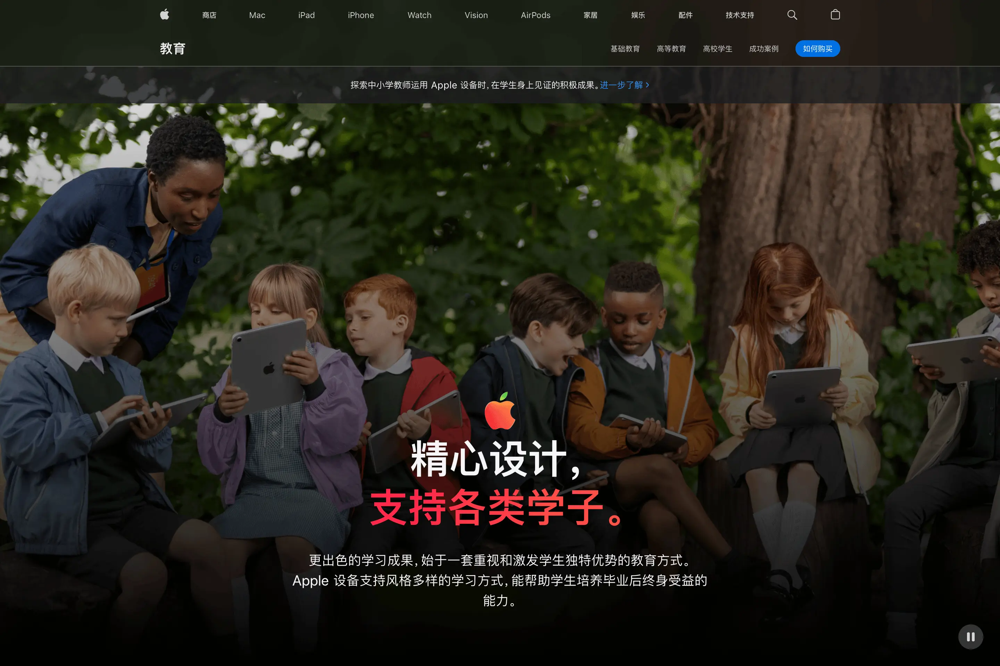
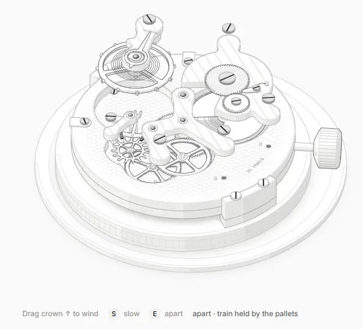

The cover was shot right after I finished writing. I had GPT touch it up — it made me think back to my Photoshop days. Who would have guessed that in less than ten years, you'd just talk to your phone and it'd be done.

> **Xuanguang Column · No.24**
>
> A digital column focused on accelerating productivity, covering knowledge management, motion visual design, and front-end development. Published at least twice a month, each issue explores a single theme.
>
> Every link I share is embedded as a hyperlink on a keyword. **WeChat official-account articles in 2026 don't support this**, though other platforms have no such problem.
>
> WeChat scans article bodies for third-party links and flags them as promotional violations. So if you're reading this inside WeChat and want one-tap jumps, tap **Read original** at the bottom.

---

## What's been happening

### A major overhaul of [Men's intro page](https://men.cgartlab.com)

I polished the homepage layout, the logo (I had to draw that one myself), and the copy. The reading experience is friendlier for newcomers now, and I moved several prerequisite concepts up front so they're introduced earlier.

My primary agent harness has shifted to OpenCode and Hermes. These tools evolve too fast to keep up — but fortunately they're not hard to pick up.

Why is it so easy to switch between them? Read on.

### Building a private shared AI knowledge base

Imagine this: you use several AI assistants across your desktop, laptop, and phone, but they don't know each other. Every time you switch to a new one, you have to reintroduce yourself from scratch — who you are, what you're working on.

That's the problem this knowledge base solves.

**It's a shared notebook that any AI can read.** All my AI assistants on different devices connect to the same "memory bank." Whenever one needs to know what's been going on, it just flips through: what tools I'm using, where my attention is, what views and habits I've picked up lately.

The data lives safely on a NAS, with a dedicated AI that collects and organizes it on a schedule.

I think this will gradually become a piece of digital infrastructure for everyone in the AI era. Tokens are cheap right now — the earlier you start, the more you'll feel the compound interest.

---

## Deep dive: reading, thinking, writing — which matters most?

This started as an answer I wrote on Zhihu a couple of days ago. It felt worth thinking through more carefully, so I'm expanding it here.

My conclusion first: **writing matters far more than reading or thinking.**

Right now, for instance, I'm writing as the thoughts come — it looks like I read the question first, thought about it, then wrote my answer. But that's a late stage. We need to look further back.

Most people think: I need to read more books first, fill up the tank, think it through, turn the water in my belly into ink — only then can I put pen to paper.

Where did the first book come from? Someone wrote it.

Why is writing more important? I think it comes down to three things.

### Writing has less friction than reading

In high school I had a "bad habit": I'd copy down quotes I thought were brilliant, then expand and twist them to match my own understanding — standing on the shoulders of giants, so to speak.

I had no concept of "read more before you write." I just copied, then revised. Finish one passage, move to the next.

Looking back, that process of revision was a kind of autopilot thinking. It didn't feel effortful.

After I started working, the habit crept back without my noticing. I didn't have time to read much — naturally, it was because I'd experienced more that I had things to write about.

That's when I concluded: writing doesn't require thinking things through first. Summon up your experiences and stories, shift into autopilot, step on the gas. A thought, once it lands on paper, has weight.

Reading can't work that way. Without thinking — just skimming — to borrow a trendy term, you might call it "Vibe Reading." In my view, you might as well not read at all. It's like the textbooks you memorized by rote: useful for nothing but passing an exam.

So I believe reading is usually more mentally taxing than writing. Writing has less friction.

### Reading is always secondhand experience

Among the quotes I copied back then, one stuck with me:

> "On the Chinese internet, there's a tip for downloading files: usually, the bigger the 'download' button on the page, the less likely it is to be the link you actually want.
>
> People are the same. Always wanting this and that — from childhood, you're taught how to 'download' knowledge, grades, diplomas. Then you start working and 'download' salary, prestige, power.
>
> The download button keeps getting bigger, and downloading a wish takes longer and longer — and duller."

The download tip is real — anyone who grew up in the 90s knows it. The second half is a connection my brain made between "download" and "desire."

At its core, it's someone else's secondhand experience plus my own firsthand experience — only because I saw it this way, thought it this way, would I write it this way.

Secondhand experience can only serve as reference, example, or corroboration. With AI, obtaining this kind of information is trivially easy now. And easy things are rarely valued.

### Writing demands your entire present

When I was studying in Thailand, I was curious about meditation. I asked my supervisor how he meditated.

He said: write down your thoughts.

He said imagine a day when you're completely exhausted. You sit down alone, grab a blank sheet of paper, and just write whatever comes. You calm down quickly. By the end, the exhaustion dissolves along with the scattered thoughts.

I was surprised. In my mind, meditation meant sitting still, not moving, breathing deeply. I'd never heard of writing as a form of it.

Later I asked other teachers when I had the chance. Their methods were all over the place — cycling, walking, swimming, hiking. All hobbies that easily put them into "flow."

I couldn't see how writing belonged in that list. But if meditation is the frame, then it must be about turning inward.

To invest your entire present like that, you have to sit down, pick up the pen, and give yourself over completely — the whole process is a conversation with yourself.

Reading, without question, is reaching outward. Imagine you're a planet. Writing is your own immense gravity. To even sustain the act of reading, you first have to overcome that gravity entirely — reach escape velocity, clear your mind of everything else — only then can you fly toward another author's planet.

Whether you actually arrive is still an open question.

---

## Recommended tools

### [Appreciating Apple's website typography](https://skywt.cn/blog/apple-typography-details)

If you work in UI or graphic design, this piece is well worth a read.

Like the author, every time Apple launches a new product I wander over to their site to see what new design tricks they've cooked up around it. But it never occurred to me that they'd actually commissioned a custom typeface just for the website.

After more than a decade of browsing Apple's site, the Chinese and English both have an indescribable rightness to them — not "more comfortable," but "this is how it should be."

> Update: [the author has open-sourced a related Skill](https://github.com/Skywt2003/chinese-web-typography).

### [Anatomy](https://skills.wheresryan.sh/anatomy)

The most impressive Skill I've seen this year.

Load it, then describe a concept in a prompt — "cache," for example — and send it to Claude.

Claude produces a 3D interactive model like the one above, using animation to demonstrate the concept vividly. It's a lot of fun.

### [Motion Reference Dictionary](https://motion-reference.takayustudio.jp/)

A game UI site. The image above is its animation reference section, collecting every graphic motion effect you could think of.

These aren't videos or GIFs — each one is live front-end code. Click a card for detailed explanations and control buttons.

---

## Videos to watch while eating

### [Storage prices are astronomical; What the AI bubble really is; All your private data is going to the cloud](https://b23.tv/n1bc9A3)

Haven't watched AK's videos in a while — still packed with substance. The product part is hard to judge, but a few points in the video I agree with:

- Right now, both compute and storage are accelerating toward the cloud.
- A growing number of people will want data localization — keeping their data off the cloud.
- If robots are the next wave, you can foresee a device with dozens of sensors and cameras walking around your house 24/7 — privacy would be a massive risk.

---

## Next issue preview

More on design: Apple's moves that aren't revolutionary but spread far and wide — the ones every other brand copies hard.

---

This column first appeared at: [CG Art Lab](https://cgartlab.com)

📮 Letters/collaboration: hello@cgartlab.com
