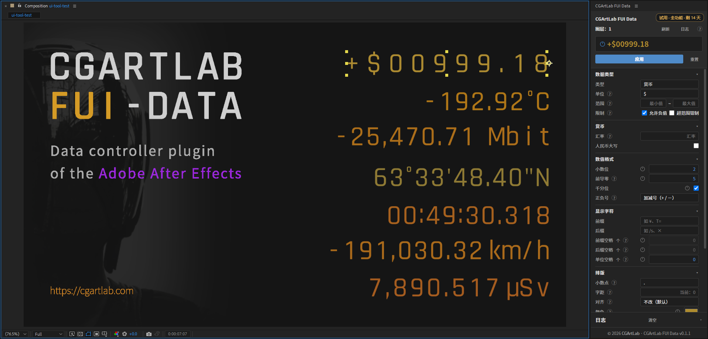
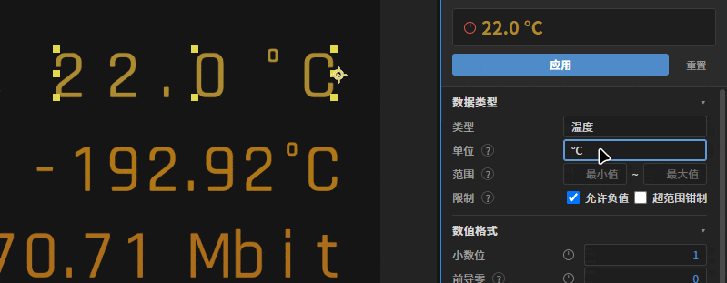
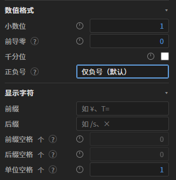
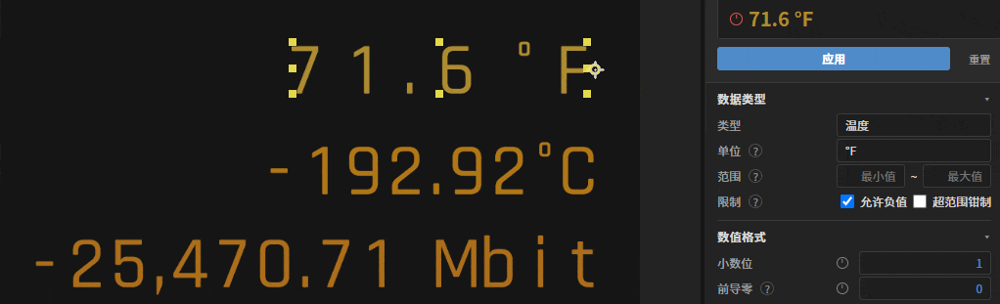
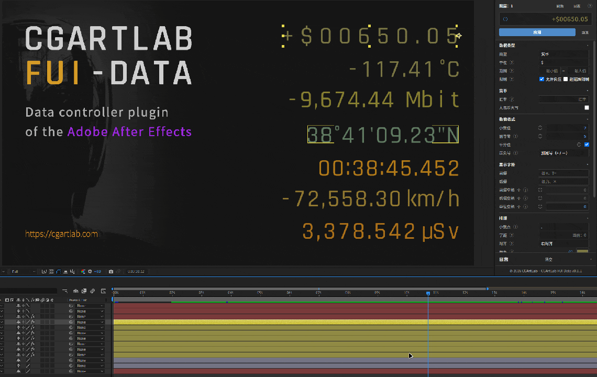

> **Public beta** (Windows · After Effects 2023+ · v0.2.0)

<a class="fui-download-btn" href="/downloads/CGArtLab-FUI-Data-0.2.0-beta-win.zip">Download CGArtLab FUI Data 0.2.0 beta</a> <a class="fui-buy-btn" href="https://item.taobao.com/item.htm?abbucket=13&id=1100985164400&mi_id=0000znNlw8x027Sj1K4d307mVGzTIceBKtLjqyJaFJqblRE&ns=1&skuId=6321972039787&spm=a21n57.1.hoverItem.10&utparam=%7B%22aplus_abtest%22%3A%2218a5645d819b3882b5a982030f95860e%22%7D&xxc=taobaoSearch">Buy license</a>

> Install: fully quit After Effects → unzip and double-click `install.cmd` → restart AE → open it from Window > Extensions > CGArtLab FUI Data.
>
> Trial: **14 days of full features, free** (34 data types / 173 units / batch apply); after that it falls back to the free 4 types (Plain Text, Number, Temperature, Percentage).
>
> Usage: select a text layer, pick a type and unit, click Apply, then keyframe Value.

## Why I made this plugin

As a motion and video designer, there's one task I've had to repeat for years: format the numbers in a shot, then make them count from one value to another.

Since I started out, the fields I've worked in include TV package design, print advertising, stage art, art toys and architectural walkthroughs (I went through them in [The program flows, the data stays](/en/posts/flow-program-iron-data/)), and I've also done human-machine interfaces (FUI) for sci-fi films, which I touched on in [that issue of the journal](/en/posts/weekly-08/).

But across all of them, the same trouble shows up whenever a number is involved: temperature, pressure and coordinates ticking in a corner of a sci-fi HUD; prices, discounts, benchmarks and multipliers on a product ad; dense data flickering across a promo; percentages and money figures in news reports — countless types.

These projects belong to different industries, but in post-production they're really all the same thing: a number plus a set of units, animated frame by frame.

Formatting and units look trivial, but they're fiddly to do. I once wrote about [how file naming affects creative speed](/en/posts/good-name-for-better-work/) — it's the same kind of problem: once the convention drifts, rework follows.

Change just one condition: a product promo also needs a second-language version. Then:

- do the units need converting?
- do the decimals need to be unified?
- do whole numbers need leading zeros?
- keep the thousands separators?
- write amounts in Chinese uppercase numerals?
- convert the time to another time zone?
- turn latitude/longitude into degrees-minutes-seconds?

The manual way is retyping, copying formats, keyframing layer by layer — and the moment a client says "switch this to USD", character widths change and all the keyframes and formatting you've built fall apart.

I wanted to get this pile of busywork — the part a program could handle — out of the workflow, so a designer only has to think about composition, pacing and ideas; [tools end up shaping how we create](/en/posts/weekly-15/), which was part of the motivation. This plugin grew out of that frustration; with AI I turned it into a complete tool (I also wrote about [AI and creative tools](/en/posts/weekly-16/) here), and today I can finally hand it to you.

If you'd like to try it, or happen to have a project that needs this, you can download the public beta right at the top of this page, or buy the commercial version.

## What it is

CGArtLab FUI Data is a standalone panel for Adobe After Effects (AE). Select a text layer, and it reads the number inside, helps you convert units, pad zeros, add thousands separators and prefixes or suffixes, and turns the text into a keyframeable animated readout.

Three steps: select a text layer, choose a type and unit in the panel, click Apply. After that, the number, unit, prefix/suffix, decimals and thousands separators all become parameters on the layer — fine-tune them in AE's Effect Controls, or edit faster by clicking the number in the panel preview; what the preview shows is exactly what gets written into the layer.

When you create a new layer you don't have to detect anything by hand: the panel reads the text once, recognizes the type and unit (e.g. 22 °C becomes temperature and Celsius), and only falls back to plain text if it can't. After that, any parameter change writes back about 260 ms after you stop, or click Apply to write immediately.

## Teaching video

The video below introduces the plugin and shows how it works in AE.

::bilibili{id="BV146WU6CESN"}

## Places that need readouts, more than you'd think

I built it for film FUI at first, but after using it I found that any shot with a moving, changing number reaches into far more fields and industries.

Ads and promos are the most common: prices, discounts, battery life and benchmarks often have several decimal-precise readouts popping out within seconds, and switching regions means changing the currency and units too.

Launch events and trade-show screens are another: a product's specs are usually a dozen-plus numbers shown together, timed to the presenter.

Rising and falling percentages in news videos, scores and timing in sports broadcasts, temperature, heart rate and blood pressure in medical, industrial and energy demos, and timecodes, countdowns, coordinates and numbers in TV packaging and stage work — they're all using the same thing.

The unit and precision each number needs differ, but the base is one number with a font, format and unit, changing in value and color over time.

## The repetitive work it takes off your hands

The core, I think, is unit conversion.

For example, for temperature, change 22 °C to °F and the number automatically becomes 71.6; and animations you've already keyframed are re-converted as a whole to the new unit, keeping timing and curves. The conversion happens once, the moment you click Apply in the plugin, and the whole layer's timeline data is converted; if you've keyframed in AE, you know how much rework that saves.

Then data formatting. I turned almost everything adjustable in classic AE into parameters: decimals, leading zeros, thousands separators, sign, prefix/suffix, decimal-point style, tracking, alignment and text color — all adjustable right in the panel.

Batch is another scenario I can't live without. Select multiple layers and apply layer by layer; when a layer's type or parameters differ from the others, that field shows "— Multiple values", and fields you haven't touched keep each layer's original value instead of being flattened — which matches how you'd expect to batch different data layers; anchors can also align to the nine-grid edges or corners of the text, so the position doesn't jump when you edit the content.

I also took care of some smaller details:

- Data types cover 30+ common measurement units, with direct conversion for some high-frequency units.
- RMB in Chinese uppercase numerals, timecodes beyond 24 hours and negative values, and lat/long in degrees-minutes-seconds — these special but common formats are built in.
- Both the value and the format can be keyframed — e.g. keyframe decimals between 0 and 2 and the readout "steps".
- The number in the preview box can be edited directly.
- Once a value exceeds ±1,000,000, it switches to an unlimited control, and existing keyframes move with it.
- Values can change color to show different states.
- Layer anchor alignment is baked in.
- After clicking Apply, the relevant parameters are exposed on AE's native panel, so even if the plugin is uninstalled, your project file isn't damaged.

## How to get started

It's simple: download the zip, unzip and install, then open it from Window > Extensions > CGArtLab FUI Data in AE. On Windows there's a one-click install script that puts the files in place, clears old leftovers and needs no admin rights.

For first use, try it in a fresh project rather than a live one. Create a text layer, type 22.0 °C, select it; the panel recognizes the type as temperature and the unit as °C; pick a unit and click Apply, and the layer gains "Value" and a set of format controls, with the text becoming an auto-updating readout.

Note: the plugin doesn't save the project, and Ctrl+Z can't undo a batch change in one step — back up first.

The public beta gives you 14 days of full features: 34 data types, 173 units, and everything shown in the video; when it ends it falls back to the free 4 types (Plain Text, Number, Temperature, Percentage).

The commercial version is available now — [buy here](https://item.taobao.com/item.htm?abbucket=13&id=1100985164400&mi_id=0000znNlw8x027Sj1K4d307mVGzTIceBKtLjqyJaFJqblRE&ns=1&skuId=6321972039787&spm=a21n57.1.hoverItem.10&utparam=%7B%22aplus_abtest%22%3A%2218a5645d819b3882b5a982030f95860e%22%7D&xxc=taobaoSearch) for a lifetime license, usable on up to two computers, with lifetime updates; the early-bird price for the first 100 is ¥59, then ¥99.

## Some limits and known issues

Windows only for now; a macOS version may be considered in the future.

It only handles text layers; shapes, solids and null objects don't apply.

The main text layer doesn't expose font and size (the prefix and suffix can be set separately).

The plugin UI is Simplified Chinese by default, regardless of your AE language.

It should support AE 2023 and later, but I haven't tested everything given limited time — feedback is welcome.

Currency rates are configured manually; there are no live online rates.

For the ‰ percentage symbol there's a quirk: above 10% the readout shows 100‰; for larger values, use Number with a ‰ suffix.

It doesn't handle composition, pacing or ideas, and doesn't replace typography. Font, size and tracking still belong in AE; this tool takes over the repetitive work.

## Some thoughts

First, learning and practicing how to build a small tool that solves your own problem (like the [LayerRenamer](/en/posts/layerrenamer/) I made earlier) is a very interesting process, and I believe that experience is something you benefit from for life. Whether the tool succeeds doesn't actually matter that much.

Why am I so sure?

One reason: the ability to distill a real pain point and package it is itself general and long-lasting. Even if the tool is niche, the fact that you built it means you've saved your future self countless hours.

Second, scaling it up — being good enough to save others' time, even to make them willing to pay — requires learning more fields and extra skills, and before any success it already brings huge personal benefit.

Third, it gives you a new perspective. As someone who used to just execute as a vendor, once you start building tools or products and face problems from that angle, your role and identity change, your perspective changes, and the questions you think about become more comprehensive and more general.

There's another point: some may think AI can solve these problems now or soon, and I don't deny it. But first, the design and production behind video faces a very complex problem. If it's just changing a few numbers on screen, that's easy.

But why change? How? Under what conditions? What state does the number reflect? Which story beats does it correspond to? That's a complex, comprehensive problem.

And that comprehensive problem can only be handled by people, and faster, because people need to communicate with each other. When you make changes, it ultimately lands on people — the last few tedious steps — which are actually better suited to a program.

If you hand such a complex problem straight to AI, you'll find you have to feed it enormous context up front, which doesn't really make the problem easier. The human brain is naturally suited to this kind of complex context, while AI is better at organizing information, gathering material, summarizing and outputting code — it's better at breaking a complex problem down, helping people abstract, and letting people decide which solution to use.
