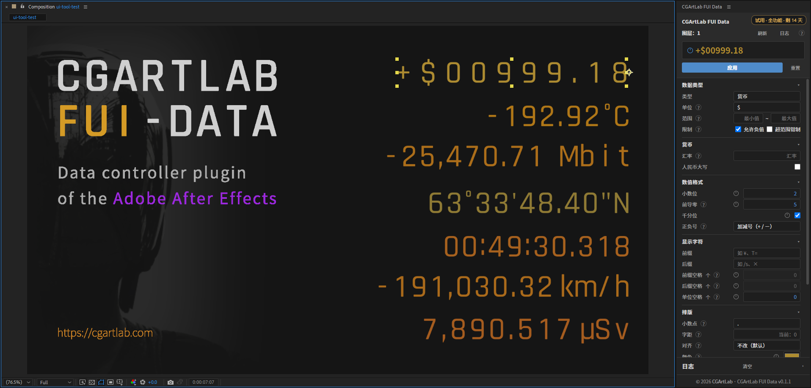
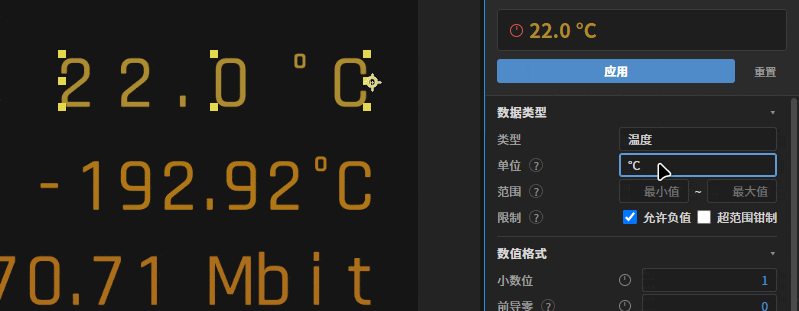
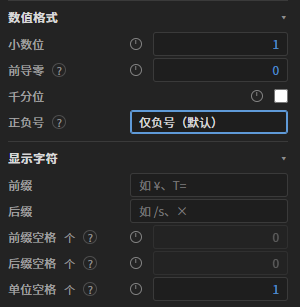
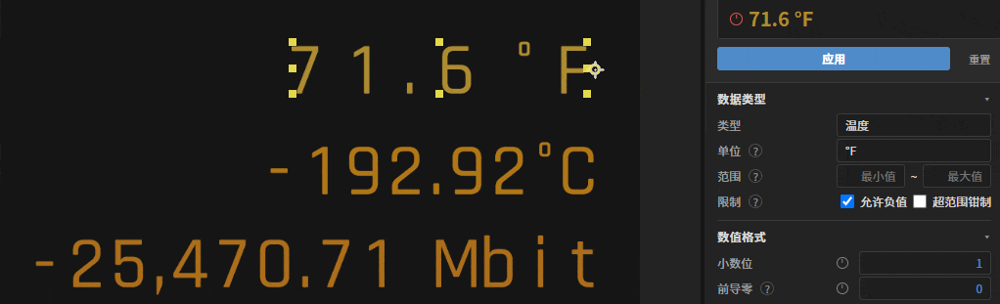
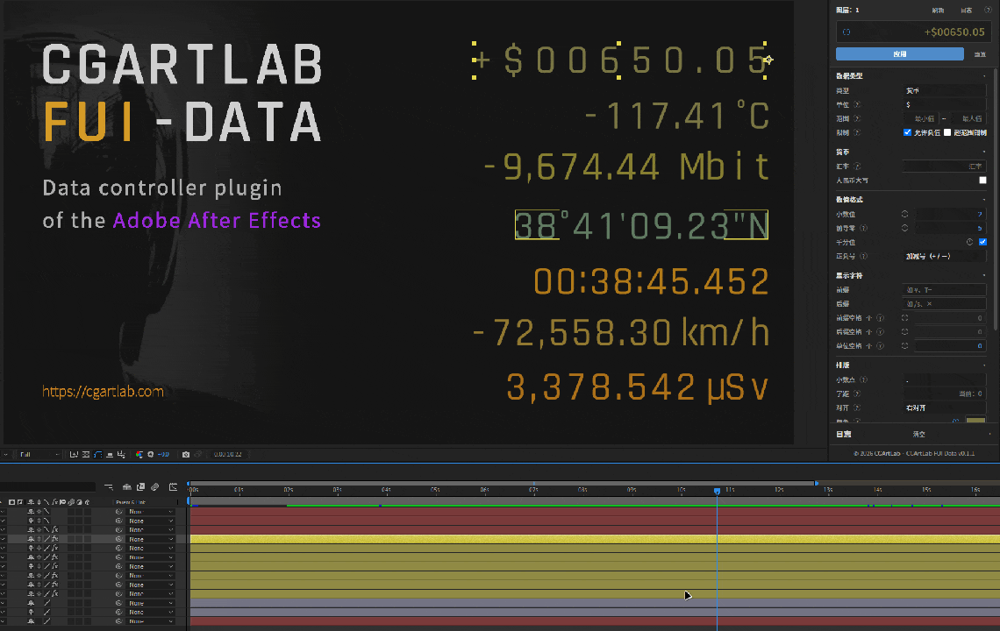

> **公测版下载**（Windows · After Effects 2023+ · v0.2.0）

<a class="fui-download-btn" href="/downloads/CGArtLab-FUI-Data-0.2.0-beta-win.zip">下载 CGArtLab FUI Data 0.2.0 公测版</a> <a class="fui-buy-btn" href="https://item.taobao.com/item.htm?abbucket=13&id=1100985164400&mi_id=0000znNlw8x027Sj1K4d307mVGzTIceBKtLjqyJaFJqblRE&ns=1&skuId=6321972039787&spm=a21n57.1.hoverItem.10&utparam=%7B%22aplus_abtest%22%3A%2218a5645d819b3882b5a982030f95860e%22%7D&xxc=taobaoSearch">购买授权码</a>

> 安装：完全退出 After Effects → 解压后双击 `install.cmd` → 重启 AE → 菜单「窗口 > 扩展 > CGArtLab FUI Data」打开。
>
> 试用：安装后 **14 天内全功能免费**（34 类数据 / 173 单位 / 批量应用）；到期后自动收回为免费 4 类（纯文本、通用数字、温度、百分比）。
>
> 用法：在 AE 里选中文字图层 → 选好类型和单位 → 点【应用】→ 给「数值」打关键帧。

## 为什么做这个插件

做动态视觉设计师这些年，我经常需要重复这个动作：把画面里的数字做好格式，再让它从一个数到另一个数动起来。

从开始入行到现在，我涉猎的领域包括电视栏目包装、平面广告、舞台美术、潮玩、建筑漫游（这些年在[《流水的程序，铁打的数据》](/posts/flow-program-iron-data/)里也盘过），也做过科幻片里的人机交互界面（FUI），FUI 这块在[《金沙滩的松树》那期周刊](/posts/weekly-08/)里聊过。

接触了这么多领域，可只要有数字出现，这个麻烦就总会出现。画面角落里跳动的温度、压力和坐标，广告里产品的售价、折扣、跑分和倍数，产品宣传片上跳动的繁复数据，新闻报道里的百分比和金额，等等，无数类型。

这些项目分属不同行业，在后期制作里其实都是一个数字配上一套单位，然后一帧一帧让它变化就行了。

格式和单位这东西看着不起眼，做起来特别琐碎。之前写过[文件命名怎么影响创作效率](/posts/good-name-for-better-work/)，其实是同一类问题：规范一旦散掉，返工就跟着来了。

比如，只变动一个条件：假设一个产品宣传视频要输出第二语言版本，那么：

- 单位要不要换算？
- 小数位要不要统一？
- 整数要不要在前面补零？
- 要不要保留千分位符？
- 金额要不要写成人民币大写？
- 时间要不要换算时区？
- 经纬度要不要换成度分秒？

手工的做法只能是改文字、复制格式、一层层打关键帧，但凡中途客户一句「这个换成美元」，字符宽度就变了，前面打好的关键帧和格式就全得推倒重来。

我一直想把这一堆明明可以用程序搞定的琐事从流程里干掉，设计师只需要考虑构图、节奏和创意，[工具其实会反过来塑造创作方式](/posts/weekly-15/)，这也是我做它的一个动机。这个插件就是被这些琐事一点点逼出来的，现在借助 AI 把它做成一个完整的工具（关于 AI 和创意工具，[这篇](/posts/weekly-16/)也聊过），今天终于能给大伙儿端上来了。

感兴趣想试试，或手上正好有项目要做这块的小伙伴，可以在页面顶部直接下载公测版，也可以购买正式商用版。

## 它是什么

CGArtLab FUI Data 是 Adobe After Effects（简称 AE）里的一个独立面板。你在 AE 里选中一个文字图层，它会把图层里的数字读出来，帮你换单位、补零、加千分位、加前后缀，再把这段文字变成一条能打关键帧的动画读数。

上手就三步：选中文字图层，在面板里选好类型和单位，点【应用】。之后数字、单位、前后缀、小数位、千分位都成了图层上的参数，想细调就去 AE 的「效果控件」里改，想快点就直接点面板预览里的数字；预览里显示的那行字，就是最后写进图层的样子。

新建图层时不用先手动检测，它会自己读一遍文字、把类型和单位认出来（比如 22 °C 就认成温度和摄氏度），实在认不出才退回纯文本；之后你改任何参数，停手约 260 毫秒它就会自动写回图层，急着要结果就点一下【应用】。

## 教学视频

下面是正式介绍这个插件的视频，能比较直观地看到它在 AE 里怎么用。

::bilibili{id="BV146WU6CESN"}

## 需要读数的地方，比想象中多

一开始我是冲着影视 FUI 去做的，做完用下来才发现，只要我需要做的视频画面里需要一个会动、会变的数字，那其实可以延展到非常多的领域和行业。

广告和商业宣传片算是最常见的一类：产品的价格、折扣、续航、跑分，常常要在几秒里接连跳出好几个精确到小数位的读数，换个投放地区，币种和单位还得跟着一起改。

发布会、展会的大屏又是另一类，产品相关的参数通常有十几组数字需要配合展示，还要卡着讲解的节奏。

新闻视频里常见的上升、下降百分比，体育直播的比分、计时，医疗、工业、能源演示里的体温、心率、压力、电压，以及栏目包装和舞台上的时间码、倒计时、坐标、编号，其实也都在用同一套东西。

这些数字对单位和精度的要求各不相同，但底子都是一个数字，配一套字体、格式和单位，再伴随时间在数据和颜色上做变动。

## 它替你省掉的重复劳动

我觉得最核心的是单位换算。

比如，做的是温度，把 22 °C 改成 °F，数字会自动变成 71.6，而且那些已经打好关键帧的动画会按新旧单位整体重新换算，时间点和动画曲线也都保留；换算只在插件里点「应用」的那一下发生一次，整个图层时间线上的数据就全部换算完成了。这个只要你在 AE 里 K 过动画，就知道它省了多少返工。

然后是数据格式。我把传统 AE 里能调的地方几乎都做成了参数：小数位、前导零、千分位、正负号、前缀后缀、小数点样式、字距、对齐、文字颜色，全都能在面板里直接调整。

批量是另一个我离不开的场景。多选图层之后逐层应用，哪一层的类型或参数跟别人不一样，就在那一栏显示「— 多值」，而你没动过的字段会保留每层原来的数值，不会被一刀切，更符合批量处理不同数据图层的直觉；锚点还能按九宫格对齐到文字的边或角，改内容的时候画面位置不会跟着跳。

剩下一些零碎的细节问题我也顺手做了：

- 数据类型支持 30 多种常用计量单位，部分高频单位支持直接换算。
- 人民币支持中文大写，时间码可设置成超过 24 小时和负值，经纬度的度分秒写法，等等这些特殊但也常用的格式是现成的。
- 数值和格式都能打关键帧，比如把小数位在 0 和 2 之间打两帧，读数就会跳一下。
- 预览框里的数字能直接编辑。
- 数值一旦超过 ±100 万，会自动换成没有上限的控件，原来打的关键帧也跟着搬过去。
- 数值支持颜色变化，用来表现各种状态。
- 集成了图层锚点统一对齐。
- 点击「应用」后会自动暴露相关参数到原生 AE 的配置面板，即使插件卸载，也不会损坏你的工程文件。

## 如何上手

非常简单，下载会得到一个压缩包，解压之后安装，再点击 AE 的「窗口 > 扩展 > CGArtLab FUI Data」打开。Windows 上有一键安装脚本，会把文件放进对应目录、清掉旧版本残留，全程不用管理员权限。

第一次使用，建议新开一个工程在里面测试和练手。新建一个文字图层、输入 22.0 °C，选中它，面板会把类型认成温度、单位认成 °C；选好单位点「应用」，图层上就多出「数值」和一组格式控件，文字变成自动更新的读数。

注意：插件并不保存工程，Ctrl + Z 目前并不能一次撤回批量的修改，注意提前备份。

公测版装完有 14 天全功能试用，总共包含 34 类数据、173 个单位，以及视频里讲述的所有功能；到期会自动回落到 4 项免费档（纯文本、通用数字、温度、百分比）。

正式商用版目前可直接[在此购买](https://item.taobao.com/item.htm?abbucket=13&id=1100985164400&mi_id=0000znNlw8x027Sj1K4d307mVGzTIceBKtLjqyJaFJqblRE&ns=1&skuId=6321972039787&spm=a21n57.1.hoverItem.10&utparam=%7B%22aplus_abtest%22%3A%2218a5645d819b3882b5a982030f95860e%22%7D&xxc=taobaoSearch)永久授权码，支持最多两台电脑同时使用，终身版本更新，前 100 名早鸟价格为 59 元，之后恢复为 99 元。

## 一些边界和已知问题

目前只支持 Windows 系统，macOS 版本未来考虑兼容。

它只负责处理文字图层，其他图层例如形状、纯色、空对象都用不上。

主文字层不提供字体和字号入口，前缀后缀可以单独设置。

插件默认就是简体中文，和你使用的 AE 语言版本无关。

理论上支持 AE 2023 以上的版本，但我时间有限，并没有全量测试，需要大家的反馈。

货币汇率需要手动配置，不支持联网获取实时汇率。

百分比符号选 ‰ 的时候还有个毛病，超过 10% 的读数会显示成 100‰，需要更大的数，就用「通用数字」加后缀 ‰。

它不负责构图、节奏和创意，也不替代排版。字体、字号、字距这些精细活儿还得在 AE 里做，这个工具承担的是重复劳动。

## 一些思考

首先，学习和实践如何开发一个解决自己问题的小工具（像我之前做的 [LayerRenamer](/posts/layerrenamer/) 就是这类），是个非常有趣的过程，我相信这样的经验和实践是可以终身受益的。这个工具是否成功，其实不那么重要。

为什么我会这么笃定？

一个是把真实的痛点问题进行提炼和打包处理的能力，本身就具有通用性和长期价值。即使这个工具十分小众，但能做出来，就意味着已经帮助未来的我自己节约了无数时间。

其次，把它放大，需要我做得好到可以节约他人的时间，甚至让人愿意花费真金白银，是需要学习更多领域和额外能力的，在成功之前就已经对个人发展产生了巨大的好处。

再一个是，它会产生一个新的视角。以前做东西的我只是一个执行的乙方，但一旦你开始开发工具或者产品，从这个角度去面对问题的时候，你的角色和身份就会变了，你思考的问题一定会更全面，而且更通用。

还有一个，可能有的人会觉得现在或者未来 AI 马上就可以解决这些问题，我当然不否认。但我觉得，首先，视频的设计和制作背后面对的是一个非常复杂的问题。如果只是修改画面上的某几个数字，这是容易的。

但为什么改？怎么改？在什么情况下改？这个数字反映的是什么状态？它对应的是哪些剧情？其实是一个复杂的综合问题。

而这个综合问题，只能由人来处理，而且更快，因为人需要人和人之间的沟通。那么在去修改的时候，最后落在人身上，也就是最后一些繁琐的步骤，而这其实更适合程序去执行。

如果你直接把如此复杂的问题让 AI 去处理，会发现你要提前输入巨量的上下文，这并没有让问题变得更容易处理。但人脑天生适合处理这种复杂的上下文，而 AI 更擅长整理信息、收集资料、归纳总结、输出代码，相当于它更擅长把一个复杂问题拆解，来辅助人做抽象，最后让人判断使用怎样的解决方案。

